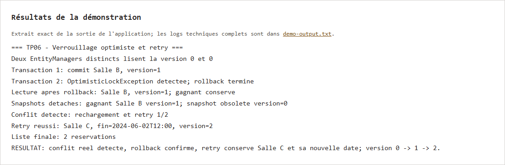
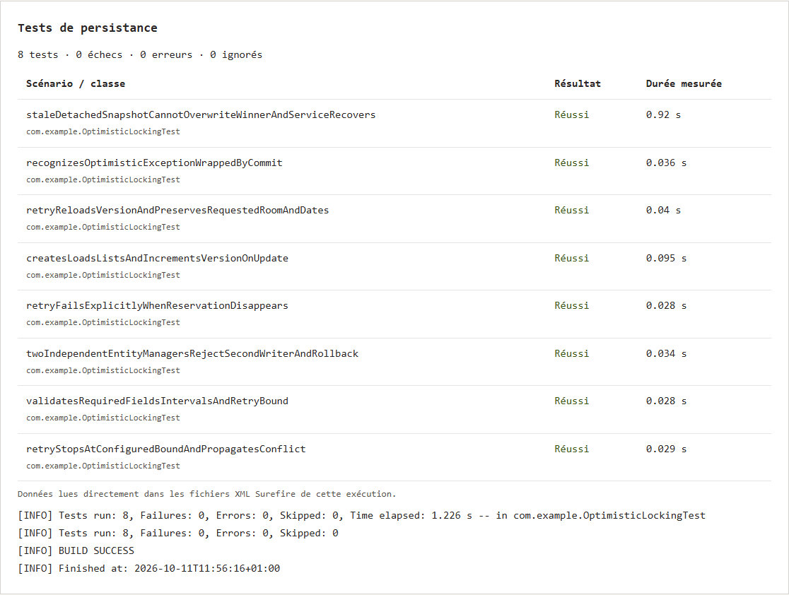

# TP 6 — Verrouillage optimiste et gestion des conflits

Ce TP montre ce qui se passe quand deux transactions modifient la même réservation. Le champ `@Version` permet de détecter un objet qui n'est plus à jour. J'ai aussi ajouté une reprise qui recharge la réservation avant de retenter la modification, avec une limite de 3 tentatives.

Pour lancer le projet, il faut Java 17 et Maven. La base H2 est en mémoire.

```sh
mvn test
mvn exec:java
```

Dans la démo, Salle B est enregistrée en version 1 et la modification concurrente est refusée. La reprise enregistre ensuite Salle C avec la nouvelle date en version 2. Les 8 tests passent.

Les captures montrent le rapport des résultats. Les sorties d'exécution sont dans `evidence/`.




